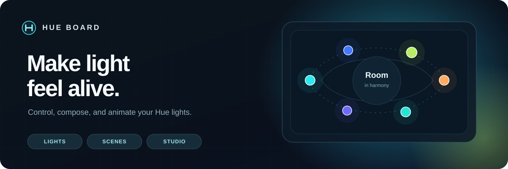

<p align="center">
  
</p>

<p align="center"><strong>Light, composed.</strong> An independent open-source Philips Hue lighting dashboard and creative scene studio for iPhone.</p>

<p align="center">
  <a href="#native-ios-app">Native iOS</a> ·
  <a href="#scriptable-installation">Scriptable</a> ·
  <a href="#playback-and-background-behavior">Playback</a> ·
  <a href="docs/architecture.md">Architecture</a> ·
  <a href="docs/audit-2026-11-08.md">Audit</a> ·
  <a href="docs/v6/README.md">V6 Program</a> ·
  <a href="LICENSE">MIT</a>
</p>

## A lighting instrument for everyday rooms

- **Lights:** room and zone power, brightness, individual fixtures, and honest Bridge readback.
- **Scenes:** 32 curated looks, visual previews, and one-tap automatic **Play** on the Hue Bridge.
- **Native Live / Studio:** deterministic procedural lighting sampled in explicit, bounded sessions. High-rate temporal fidelity requires a supported Hue Entertainment transport.

## Native iOS app

Native SwiftUI is now Hue Board’s primary product direction. The implementation under [`ios/`](ios/README.md) provides system-native Lights, Scenes, Native Live, Settings, Bridge pairing, restore recovery, and playback status surfaces.

The native app shares a generated contract with Scriptable: **32 looks, 24 patterns, and 19 palettes**. Its `HueBoardAppleEngine` target runs the exact shared JavaScript engine through JavaScriptCore, verifies the bundled runtime digest before use, and recomputes a canonical SHA-256 over **512 deterministic scene frames** on Apple test hosts.

- **Play** creates or updates a compatible Bridge-native dynamic scene. Once the Bridge acknowledges recall, playback continues independently of the phone.
- **Native Live** samples the exact Hue Board engine on the iPhone and sends conservative, long REST transitions for an explicit, duration-bounded session. It is not high-rate Hue Entertainment streaming.
- On iOS 18–25, Native Live is foreground-only. On iOS 26+, a user-started session requests continued processing, reports progress, and remains subject to system cancellation and expiration.
- Opening, pairing, refreshing, browsing, and changing tabs never write to lights.

The current native app is a reviewable vertical slice, **not** an App Store release. Xcode semantic compilation, simulator/device launch, physical Hue behavior, lifecycle, accessibility, energy, and thermal qualification remain required. See the [native build and parity guide](ios/README.md).

## Scriptable installation

**Release qualification pending:** This branch implements automatic phone-free Play in source, but the published GitHub installer and checked-in `dist/` still contain **v5.2.0**. Do not use those files expecting v5.3 behavior. A new compiled bundle, immutable release SHA-256, and pinned installer must be published and checked before release.

For now, use the verified v5.2.0 installer from `main` or inspect the local v5.3 source candidate. The source branch is **not a new installable Scriptable release**.

The currently verified standalone controller is [`dist/hue-board.js`](dist/hue-board.js). The pinned installer checks its immutable commit and SHA-256 before replacing an existing Scriptable file.

The eventual v5.3 Scriptable installation will continue to require trusted Wi-Fi, preserve existing Hue credentials and baselines, and never turn lights on merely by opening the app.

## Playback and background behavior

| User action | When phone locks | Fidelity |
| --- | --- | --- |
| **Play** on a compatible room | **Hue Bridge keeps playing automatically** after accepted scene recall | Compatible Bridge-native dynamic palette, not exact Live choreography |
| **Native Live**, iOS 26+ | Requests a bounded, user-visible continued-processing session | Exact shared-engine samples over low-rate, long REST transitions; system may cancel or expire it |
| **Native Live**, iOS 18–25 | Stops sending updates when the app is suspended | Exact shared-engine samples over low-rate, long REST transitions while foregrounded |
| **Scriptable Live Studio** | Stops sending animation updates when Scriptable is suspended | Existing foreground procedural controller |
| **Stop & restore** | Explicit command when Hue Board is available | Restores captured static state; review timestamps and competing-controller changes |

There is no background toggle and no silent fallback to a foreground-only animation when automatic Play is unsupported. Real Hue rooms/zones and eligible dynamic color lamps are required. Unacknowledged recall is displayed as **uncertain**, not as successful playback.

Bridge dynamic scenes do not reproduce Hue Board’s exact 24-pattern engine. Native Live preserves the engine’s sampled state but deliberately limits REST frequency to long transition cycles. iOS continued processing is bounded and system-controlled rather than a permanent daemon. A future supported Hue Entertainment transport remains required for high-rate temporal choreography.

## Develop and verify

Node 22 and pnpm 10.17.1:

```sh
corepack enable
pnpm install --frozen-lockfile
pnpm verify:release   # committed pinned Scriptable artifact, before rebuild
pnpm build
pnpm verify:rebuild   # rebuilt Scriptable artifact must match published artifact
pnpm test
pnpm test:timing
```

Native iOS development requires Xcode 26+ and XcodeGen 2.46.0:

```sh
cd ios
make parity
make project
make build
```

Source lives in `src/`, `frontend/`, and `ios/`; `dist/` is a generated Scriptable distribution, not an implementation-edit surface. See [architecture](docs/architecture.md), the [engineering audit](docs/audit-2026-11-08.md), the [native iOS guide](ios/README.md), and the canonical [Hue Board 6 finalization program](docs/v6/README.md).

The illustrative [README SVG](assets/readme/hero.svg) is source-controlled. An optional pinned [Takumi renderer](scripts/readme-art/generate.mjs) provides an alternate visual and never automatically pushes to `main`.

## Safety and provenance

The native app accepts only private-LAN Bridge hosts and rejects redirects. On first verification it requires the certificate’s Bridge ID to match the local Hue API identity, records the leaf certificate SHA-256, and pins that fingerprint for later requests. A changed certificate fails closed and requires deliberate re-verification on a trusted home network. The Hue application key remains in Keychain. This trust-on-first-use design still requires physical validation across Bridge firmware and certificate generations.

The Scriptable transport still relaxes local Bridge certificate validation, so use trusted Wi-Fi only. Bridge acknowledgement/readback does not prove emitted optical output. Source tests and mocked resources do not replace real iOS, Hue Bridge, accessibility, battery, or competing-controller validation. Restore points and previous Keychain data are preserved through migration.

[MIT license](LICENSE) · [Third-party notices](THIRD_PARTY_NOTICES.md) · [Migration](docs/migration.md)

*Unofficial project, not affiliated with or endorsed by Signify or Philips Hue.*
