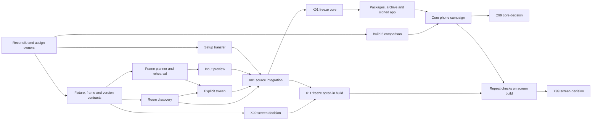

# Hue Board native 0.3.0

**Target an internal iPhone candidate.** Someone should be able to recognize their existing room, rehearse a cue or local video on that map, see what is driving the preview, and take the setup to another installation. Changing the lamps remains an explicit, bounded action with a verified way back.

**First demonstration.** Open a room whose Hue arrangement covers four of six lights. Preview and save the four positions. Scrub a two-cue mix. Preview a local video with the microphone off. Export the setup. Require a positive Debug audit activation and zero Hue write attempts throughout. A separate authorized session proves that starting and restoring the lights works. Use synthetic content and a scratch layout for edits. [Physical test matrix](../ios/DEVICE_TESTING.md) · [Existing-installation runner](../ios/DeviceSmoke/README.md)

**Execution artifacts.** The task graph defines assignments, direct dependencies, exclusive resources, acceptance criteria and evidence. The scheduler selects work for the available team. The board exporter makes a searchable offline copy. [Task graph](native-0.3.0/tasks.tsv) · [Scheduler](native-0.3.0/graph.py) · [Scheduler tests](native-0.3.0/test_graph.py) · [Board exporter](native-0.3.0/board.py)

## Starting evidence

On November 21, 2026, a direct GitHub ref query returned `a9a5d905`. Both intended checkouts had eight local commits through `fc251a4a`. The install receipt binds **0.2.2 (6)** to source `41bc092a`. On that source, 201 JavaScript tests, 94 Apple package tests, TypeScript, timing and contract regeneration passed. JavaScriptCore reproduced the schema-2, eleven-decimal 512-frame digest. The post-install state was checksum-valid and idle. Subsequent CoreDevice preflight stopped before audit activation. Reconnect, navigation, rendering, hardware input and active-color restoration on build 6 remain open. Future execution starts with fresh reconciliation. [Source and install evidence](../ios/README.md#build-6-in-place-update)

## What the audit changed

| Finding | Decision and proof |
| --- | --- |
| Build 6 already reads Hue positions. Discovery sits below the fixture settings. An empty inventory and an area with no matching fixtures currently look alike. | Surface suggestions next to the room picker. Distinguish failed reads, empty inventory and zero overlap. Test switching A → B → A while the first response is in flight. **R02–R16** [Current discovery](../ios/App/AppModel+RoomArrangement.swift) |
| A fixture can appear in the right place and animate in the wrong order. The mapper edits X/Y. Live samples the stored phase. | Keep position import and phase assignment as separate local edits. Specify ties, single-fixture behavior and ring endpoints. Compare rehearsal and fake Live at exact cue boundaries. **D01–D06, S03–S15** [Mapper](../ios/Packages/HueBoardKit/Sources/HueBoardKit/HueEntertainmentLayout.swift) · [Runner](../ios/Packages/HueBoardKit/Sources/HueBoardNativeCore/NativeLiveRunner.swift) |
| The current selection checks a fixture floor against global safety brightness. The frame calculation can raise a lower target to that floor. A 15% master, 20% fixture minimum and 80% global cap can yield a 20% command in the source path. | Treat the master as an upper bound. Share eligibility before input startup, baseline capture and target generation. Cover mixed rooms, all-ineligible rooms and floor equal to cap. This finding comes from code and a synthetic engine input. A physical measurement remains open. **S03, S06, S13** [Startup](../ios/App/AppModel+Live.swift) · [Brightness calculation](../ios/Packages/HueBoardKit/Sources/HueBoardKit/HueSpatialLayout.swift) |
| Two teams would have implemented the same frame math and edited the same entry view. | S06 owns signal-to-target math. I02 adapts the input. S07 connects the Live runner. I06 builds a separate view and S12 integrates it in Studio. Only the physical Live path acquires its writer. **F01, S06–S07, I02, I06, S12** |
| Setup import spans four persistent stores and an in-memory Studio draft. Two mappings can yield identical review text. Cues, palette and draft fields overlap. | Give each field one owner. Review an immutable diff and stage one recoverable commit. Invalidate stale reviews and inject termination at each durability boundary. **T03–T15, T17–T18** [Current importer](../ios/App/AppModel+PortableData.swift) · [Section codecs](../ios/Packages/HueBoardKit/Sources/HueBoardKit/HuePortableData.swift) |
| The write audit is compiled into Debug. A signed Debug app, an unsigned Release archive and build-for-testing establish different facts. Alternating candidates on one phone could misattribute receipts. | Track SHA, configuration, build, digest and process. Run actual assertions. Capture pre/post state in the same reservation. Close the core phone campaign before installing the screen candidate. **Q07–Q12, Q21, Q23, XQ10** [Activation](../ios/App/HueBoardApp.swift) · [HTTP hook](../ios/Packages/HueBoardKit/Sources/HueBoardNativeCore/HueBridgeClient.swift) · [CI archive](../.github/workflows/ios.yml) |
| API availability alone leaves other apps’ audio delivery and writer behavior during suspension unanswered. | Give screen color and app audio separate OS/source/lifecycle results. For a cross-app claim, use a controlled second app with the microphone disabled. Qualify any adopted mode on a separately frozen binary. **X01–X14, XQ03–XQ99, X99** |

## What ships

### Room and Studio

1. **Recognize the room.** On visible, ready, idle Room entry, discover once per Bridge/room/inventory generation. Offer Refresh and manual placement. Rank exact light IDs and unique renderer references. Show “Movie area · positions for 4 of 6 lights” and any alternate matches. Cancel leaves the map untouched. Save positions updates matched fixtures only. Preserve temporarily absent placements, previous roles, trims, ceilings and phases. Newly discovered fixtures start deselected.
2. **Qualify the map orientation.** Build 6 projects X and inverted Y and omits height. Philips’ archived SDK defines positive axes as right, front and up. Use this as the front-at-top expectation and check it against a known-direction v2 Entertainment area and a height-only difference. A no-match household can verify the empty experience. A known matching setup supplies the positive proof. HomeKit exposes room membership. Hue Board has no Apple Home coordinate reader. [Philips coordinate definition](https://github.com/PhilipsHue/HueSDK/blob/39cd6f6fff27969092af72def9384e9bb84f89e4/HueQuickStartApps/HueQuickStartApp-iOS/Dependencies/HueSDK/phone/device/HueSDK.framework/Headers/PHSGroupLightLocation.h#L16-L23) · [Apple HMRoom](https://developer.apple.com/documentation/homekit/hmroom)
3. **Rehearse on the map.** Start paused. Offer cue scrubbing, previous/next, an accessible fixture list and a labeled sample room when unpaired. Explain exclusions in a real room with no eligible lights. Reuse cue-local elapsed time, roles, gamut, trims and output limits from the shared frame plan. A 30-second cue switches at 30.000 s. Session end schedules no extra frame. Overlapping fixtures remain individually selectable.
4. **Use positions for sweep** previews a left-to-right phase assignment. Equal X values share a phase. Among distinct positions, sorted rank divided by their count keeps phases below one and avoids a duplicated endpoint on a ring. One distinct position yields no change. Save phases rechecks scope and eligibility. Dragging and importing positions preserve manual phases. This is a proposed rule with an independent synthetic oracle.
5. Keep Lights, Scenes, Studio and Room. Exercise individual-light controls, scene search and empty results, saved mixes, custom palettes, forward and seeded-shuffle cues. VoiceOver gets meaningful values and actions, large type retains access to Stop, and iOS Reduce Motion allows static stepping. Hue Board’s Reduce Light Motion governs physical playback. One-step Undo when replacing a modified draft is the first follow-up after the candidate. [Safety policy](v6/decisions/0005-physical-light-safety.md) · [Apple accessibility audits](https://developer.apple.com/documentation/accessibility/performing-accessibility-audits-for-your-app)

### Reactive lighting

**Microphone and local media are core.** Source selection is passive. Preview input opens capture or a security-scoped file on explicit action, even while unpaired. Display level with text, video tint with a non-color description, and modeled fixture response. Audio and video files work with microphone permission denied. Coalesce meter updates independently of the existing ordinary REST transition minimum, the greater of 4,500 ms and 550 ms per selected fixture. Physical Start under Reduce Light Motion uses Engine. Test denied permission, revoked file access, interruption, route change, EOF, backgrounding, rapid taps and late callbacks. Only the owning session can stop or publish its capture. [Microphone service](../ios/App/Services/StudioMicrophone.swift) · [Media service](../ios/App/Services/StudioMedia.swift) · [Apple audio interruptions](https://developer.apple.com/documentation/avfaudio/handling-audio-interruptions)

**Screen input gets two engineering days of available investigation time.** Track hardware wait separately. On iOS 27+, use an isolated probe with its own bundle/container, the system picker and a null lighting sink. Exercise in-app and full-display sharing. Use silent color bars for screen tint and a tone over a static image for app audio. For cross-app proof play those fixtures in a controlled second app while Hue Board backgrounds. Enable only the stream outputs being tested. Keep microphone and camera off and retain derived values only. Record picker outcomes, permission loss, Stop Sharing, dropped/stale samples, CPU, memory, thermal state and stop-to-drain latency. A black frame or silence alone cannot distinguish protection from valid content. Full-display background capture and background writer behavior need separate proof. [Apple iOS capture sample](https://developer.apple.com/documentation/screencapturekit/capturing-screen-content-on-ios) · [Audio output](https://developer.apple.com/documentation/screencapturekit/scstreamoutputtype/audio) · [Legacy picker deprecation](https://developer.apple.com/documentation/replaykit/rpsystembroadcastpickerview)

**At X09**, log each source/scope as supported, unavailable, or blocked. Defer at timeout or missing access. A positive result permits integration of demonstrated scopes only. Freeze a new build, repeat the XQ qualification rows and run X12/X13 for same-binary capture, bounded physical output, stop and restoration. Earlier OS versions retain the foreground Files path. High-rate Entertainment streaming, beat synchronization, gradient-strip editing and copying saved Hue scenes remain later work. [Release-train decision](v6/decisions/0001-native-ga-scope.md)

### Setup files

- **Choose what travels.** Bundle draft, palette, cues, mixes and favorites. Layouts and safety settings require opt-in. Each field has one serialized owner, including the seed shared by cues and the engine. Exercise draft-only, cues-only and combined selections. Retain the seven current section formats, canonical scene v2, Scriptable v3, 512 KiB input bound and 100-mix limit. Offer individual exports for larger selections.
- **Review exact changes.** Show additions, identical skips, same-ID/different-content conflicts, unmatched placements and each ceiling increase with old/new values. Equal display names are allowed. A new bundle carries original scope for opted-in layouts. If legacy scope is insufficient, require an explicit exact-ID review or skip the placement. A different Bridge can import portable content. Revalidate the compared values, current room, safety and recovery at confirmation.
- **Survive interruption.** Stage and validate all selected sections. Readers must see a complete old or complete new durable set across mixes, favorites, scoped layouts and safety preferences. Choose the smallest design that passes forced-termination tests. A staged generation switched atomically is one option if all affected readers participate. Test normal edits, competing Start, emergency Off, disk failure, crash before UI publication and repeat import. The portable transaction cannot touch the physical recovery journal, Keychain or consent. Publish the transient draft after durable success and explain its **Save as mix** lifetime. [Existing transfers](../ios/README.md#transfer-local-data) · [Compatibility policy](v6/decisions/0002-version-and-schema-model.md)

## Parallel execution

The graph contains **166 tasks and 385 direct dependency edges** across core and optional paths. The core target is **123 tasks**. Each TSV row gives the task ID, lane, direct prerequisites, exclusive locks, deliverable, pass condition, source or planned surface, and expected receipt. Dependencies are AND conditions.

| Target | Use | Exit |
| --- | --- | --- |
| A01 | Integrate core source while the phone is unavailable | All four feature lanes and independent safety/integration cases have reviewed source and runnable tests. Outstanding runtime results stay visible. |
| Q99 | Qualify the internal core candidate | Current signed-device, source, accessibility, physical and recovery receipts pass. |
| X09 | Investigate iOS 27 screen color and app audio | Record results by scope and make an explicit inclusion or deferral decision. |
| X99 | Qualify a separately frozen screen-enabled candidate | Repeat the XQ matrix and each adopted screen proof. The shared-phone install waits for the core campaign to close. |



### How to dispatch the teams

1. A coordinator owns Git integration, file assignments, native build reservations, signing and physical actions. Give each implementation row one owner. Assign an independent reviewer for identity, caps, transaction and recovery changes. Use isolated worktrees from the recorded SHA. Record intended write paths before editing. Additional workers can build independent oracles, media, accessibility scenarios and failure cases. Return to the coordinator before editing a file another team owns. [Git worktree](https://git-scm.com/docs/git-worktree)
2. Dispatch a ready batch and refill slots at each handoff. With six workers and the Mac and phone unavailable, the first batch after reconciliation covers scope, evidence format, ownership, fixture oracles, version compatibility and accessibility. B06 opens implementation after the ownership and scope decisions. Every dispatcher must use the same assignment ledger. The helper recommends batches and never launches tasks or grants authority.
3. Acquire a row’s locks together. A shared file has one integration owner. The area column may also cite a read-only reference or planned path. A source row that names XCTest defines its test deliverable and oracle. Actual Xcode execution on the shared Mac always reserves `mac-native`. Alternate hosts and isolated phones need explicit reservations for their actual destinations. Keep one campaign on the paired phone through its final state receipt, including visual and Files checks. Recheck installed identity and fresh state at each reacquisition.
4. Hand off the task ID, owner, reviewed diff, base/output SHA, changed paths, test selectors, commands, assertions, limitations and next consumer. Runtime receipts add configuration, artifact hash, toolchain, device/OS class, observed result and private evidence pointer. Store receipt references in the ledger so the next team can work without the producing agent’s conversation.
5. Set `done` only when the row’s acceptance is satisfied. A timeout, missing audit marker or unverified physical run stays open. Q02 allows a dated disposition for an unavailable historical comparison. Q22 allows an exact-SHA alternate-host receipt for the internal source gate while hosted CI remains pending. A screen no-go cannot unlock X10. On divergence, put affected work on hold, release reservations, invalidate receipts for affected descendants and replan against the observed state.

From the repository root, these commands inspect the graph. The `--done B01` example assumes reconciliation has actually passed. On the source Mac use `rtk proxy uv run --no-project python` in place of `python3`.

```sh
python3 docs/native-0.3.0/graph.py check
python3 docs/native-0.3.0/graph.py show S03
python3 docs/native-0.3.0/graph.py ready --target Q99 --done B01 --slots 6 --unavailable-locks mac-native,phone
python3 docs/native-0.3.0/graph.py waves --target A01 --slots 16
python3 docs/native-0.3.0/test_graph.py
python3 docs/native-0.3.0/board.py > /tmp/hue-board-0.3.0-tasks.html
```

**Capacity.** The core graph’s longest chain is 30 tasks. A deterministic simulation treating every task as one unit gives 44 batches with six workers, 42 with sixteen, and 42 with thirty-two. These figures compare schedules. Elapsed time depends on task effort, host availability and device access. The frame planner, Studio integration, candidate freeze and single phone campaign drive the longest chain. Additional workers help most on independent test oracles, reviews and isolated hosts.

## Evidence and release decision

| Gate | A passing receipt establishes |
| --- | --- |
| **Q01–Q02 · historical comparison** | Verify the actual installed identity and state. Attempt build 6 browsing while the installation is available. If it has changed or remains unreachable, record the exact blocker and dated receipts. Preserve pairing and the original backup. Never downgrade, clear a journal or trigger a restore to obtain this comparison. |
| **Q04–Q10 · source and binary** | Run full JS/TS/timing checks, clean generator, Apple package tests and the 512-frame digest. Execute app/UI tests on a healthy host or an appropriate isolated device. Verify the Release archive and privacy payload. Separately bind the signed Debug app and standalone runner to the SHA, check identity and provisioning continuity, update in place, and verify fresh idle state. Compilation alone supplies no runtime assertions. |
| **Q11–Q14, Q24–Q25 · browse and preview** | Use standalone DeviceSmoke with `-collect-test-diagnostics never`. Bind completed assertions and screenshots to the same process, positive `HUE_BOARD_WRITE_AUDIT_ACTIVE`, zero attempts and fresh checksum-valid pre/post idle copies without recovery or live descriptors. Inspect all tabs, sheet, search/keyboard, Room, Studio, Files, long text, VoiceOver and motion settings. Compare local edits with the explicitly approved scratch data. |
| **Q15–Q20, Q26–Q29 · physical behavior** | Obtain current authorization for each fixture set, action, cap, input, duration, stop and restoration. Check a fresh valid state, eligible capabilities, original Bridge and one writer for each run. Exercise explicit individual control, Bridge Play under lock, selected-only cues, mic, local audio and video, emergency Off, relaunch and reconnect. Check saved power, brightness and active XY or mirek against fresh readback. Keep unresolved snapshots after partial failure. Record command acceptance, readback and observed lamp behavior separately. |
| **Q21–Q23, Q99 · decision** | Identify actual runner availability, source and binary identity, privacy review, and zero open P0/P1 defects for the promised scope. Raw screenshots, backups, media, home identifiers and signing details stay private. A changed binary reopens candidate qualification. An unhealthy simulator can move to a suitable host. An unavailable paired system leaves physical qualification open. Keep the Mac running per the owner’s instruction. |

If the candidate fails, stop promotion, preserve the installation and recovery evidence, and fix the source on a new candidate revision. Signed Release runtime, TestFlight and public distribution each require their own evidence and decision. [Qualification guide](../ios/DeviceSmoke/README.md) · [Release scope](v6/README.md)
