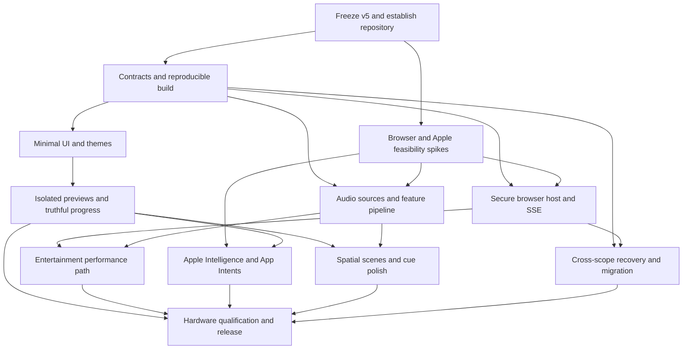

# Hue Board v6: implementation plan

Prepared November 5, 2026. Status: proposed implementation plan, not a new application release.

## Decision

Use a **GitHub repository as the canonical development home**, initially private. Keep Gists optional for a small redacted reproducer or pointer to a release, never as the application source of truth or a credential store. A secret Gist is unlisted, not access-controlled private storage. [S1]

V6 should turn the existing application into a coherent lighting instrument: simple everyday controls, visual scene auditioning, honest feedback, optional sound performance, and capability-aware Apple integration. Preserve the working Scriptable distribution while removing Scriptable-specific assumptions from the shared core. Do not perform a wholesale rewrite merely to change the packaging.

The decisive separation is **interface vs. controller vs. platform capabilities**. Opening a browser, capturing audio, and invoking Apple Intelligence are different capabilities. They should share one model and intent protocol without pretending every runtime can do every job.

## Baseline actually inspected

Reviewed the delivered v5 README, validation record, standalone script runtime, source-archive manifest/build metadata, and rendered phone interface. The source ZIP contains separate engine, controller, transport, telemetry, layout, workspace, runtime, native UI, and React UI modules. The delivered script is 437,371 bytes and its SHA-256 is:

`9692d87663181b1f0cdfe7078fc2137ae01c75cff353143da1f90139fb88ade4`

V5 already contains daily light management, 100% brightness support bounded by retained fixture limits, saved Entertainment-position import, native compatibility controls, distinct observed/accepted/design states, cue sequencing, and theme matching. Its validation record explicitly does not establish physical Hue/iOS compatibility or a complete semantic React typecheck. The prior test totals are baseline records, not fresh test executions in this planning task.

No real Bridge was contacted, no repository was created, and no installed controller was changed while preparing this plan.

## 1. Product contract

The everyday experience should have three primary destinations:

- **Lights:** room selection, power, brightness, favorite scenes, and individual fixtures.
- **Scenes:** visual browsing, draft preview, cue sequences, saved mixes, and an editor with progressive disclosure.
- **Sound:** source selection, calibration, one intensity control, and audio-reactive looks.

Settings belongs behind a consistent settings button. The existing Studio functionality moves into scene editing and advanced disclosure; it is not deleted. All prior limits, ownership policies, recovery options, and source provenance remain accessible.

Proposed interaction goals, to be measured rather than asserted: room dimming should require no more than selecting the room and dragging its primary control; an individual fixture should open in one tap; a saved look should be previewable in one tap and playable by a separate explicit action; advanced configuration should never be necessary for ordinary lighting.

### UI direction

Use a restrained system-aware surface with real lamp colors as the dominant visual element. Remove duplicate headings, marketing subtitles, permanent educational callouts, and repeated scope controls from the first viewport. The currently selected room, its brightness, a few favorite looks, and the first light rows should fit before the user scrolls on a typical phone.

Use semantic Tailwind tokens and proper shadcn primitives, with source-owned React Bits animation confined to meaningful feedback and selected surfaces. Avoid continuous decorative shaders, competing animated borders, or hover-only affordances. Use system typography, readable numeric values, a consistent icon family, clear focus treatment, and touch targets of at least 44 logical points as a design target. Validate text enlargement, VoiceOver, keyboard, touch, landscape, safe areas, light/dark changes, Reduce Motion and Reduce Transparency.

Use native sheets for permissions, input routes, sharing, and Apple-specific actions. Native materials can frame those surfaces; do not recreate excessive frosted glass inside every web card.

The footer becomes context-aware: a compact Now Playing bar only when something is running. Stopped lighting does not need a disabled transport bar permanently consuming screen space. A one-tap stop remains available during any custom show or capture session.

## 2. Runtime and browser architecture

### Supported runtime tiers

| Runtime | Planned role | Boundaries |
|---|---|---|
| Scriptable export | Easy installation, daily controls, existing slow effects and compatibility UI | Foreground controller; no assumed native Foundation Models or unrestricted audio APIs |
| Browser app | Full UI, simulation, local media/microphone analysis where supported, live control through an authenticated host | No embedded Hue key; no claim of arbitrary iPhone system-audio capture or background execution |
| Native Apple shell/adapters | Swift capture, Keychain, model access, App Intents, and optional native streaming | Availability, permissions, entitlements, and actual-device validation required |
| Optional local companion | Independent controller for live browser sessions, sustained playback, SSE and Entertainment transport | Requires a running local host; do not assume the user owns or leaves one awake |

The browser app and companion are separate artifacts. A static hosted demo is not a live local-network controller. A PWA does not turn the phone into an always-on daemon.

### Open in browser

Implement two explicit modes:

**Browser preview:** a hosted/static/offline-capable UI with synthetic or explicitly exported sanitized fixture data, animated previews, and no ability to change home lights. It must label demo or cached data clearly.

**Live browser control:** the UI connects to a paired controller that owns the Hue connection. Opening the page does not itself start a show or turn lights on. The existing Scriptable `evaluateJavaScript` exchange is replaced by the same typed protocol over an authenticated connection. Scriptable's Safari.open leaves the current app; it cannot be assumed to leave the current foreground controller alive. [S4]

Preferred first live host: an optional local TypeScript/Node service reusing the existing engine and controller, with a narrow Swift helper only where macOS capture or Apple models require it. An iPhone native build is a separate path for phone-only native capabilities. Avoid reimplementing the same engine in Python and Swift merely to add transport adapters.

The host serves UI and API from the same authenticated origin. Default to loopback; enabling LAN access is explicit. On other devices, use trusted HTTPS rather than treating a private IP as a secure origin. `http://localhost` on the host has different browser trust semantics from `http://192.168...` opened on an iPhone. Microphone access and other browser APIs require an appropriate secure context. [S5, S6]

Pair clients using a short-lived code and revocable sessions. Never put the Hue application key into a URL, browser localStorage, analytics, or exported diagnostics. Enforce origin/host checks, request validation, CSRF protections where cookies are used, and an allowlist of operations rather than a general URL proxy. Address DNS rebinding. Do not disable browser CORS or certificate checks as an installation step.

### Ownership and handoff

One active lighting writer per coordinated Bridge/scope within Hue Board. Views can be many; the authoritative controller is one. Handoff transfers the scene intent, seed, active time, caps, exclusions, journal reference, and audio-source status only after the previous writer stops launching commands. Already-sent commands may finish. Coordinate through a versioned lease/epoch and display interruption truthfully; do not promise an atomic transaction the Hue API does not supply.

Respect independently owned Entertainment streams and external off policies. Hue Board's lease does not prevent another unrelated Hue application from writing.

## 3. A preview system, not animated decoration

### Five visual states with explicit meaning

| State | Meaning | Rules |
|---|---|---|
| Reported | Latest Bridge resource state | Timestamp/freshness, unknown/missing/off semantics; not optical output |
| Sent | Last target accepted for the expected resource | Acceptance is not proof a physical bulb reached it |
| Estimated fade | Optional interpolation between accepted states | Clearly estimated; reset on new observations or ownership changes |
| Preview | Isolated draft scene rendered by the same planner | Never issues physical commands, even while another show is running |
| Audio | Actual input features such as RMS/band energy | Do not substitute random visual motion when there is no signal |

The default live view remains Reported. Scene cards and the editor use Preview. The same deterministic engine, planner, device capabilities, fixture gamut and brightness limits drive both simulation and intended targets. Tests compare planner output, not just screenshot appearance.

Current v5 preview edits can influence a running show. V6 must have separate **draft** and **live** state, with an explicit Apply/Play boundary. Editing a preview or scrubbing a timeline must not mutate live output.

### Rich visuals

Use animated scene thumbnails only while visible, a larger room preview on selection, a fixture inspector, and a timeline that can be scrubbed without changing lights. A before/after comparison helps understand a new palette or AI suggestion.

Use saved Entertainment XYZ and segment mapping where available. Offer a simple top-down default and optional elevation/2.5D inspection. Preserve the distinction between map placement, path phase and source channel geometry. Missing coordinates stay explicitly unplaced; normalized Hue positions are not metres. Do not jitter overlapping lamps or fabricate physical room geometry.

Room glow/shadow effects are illustrative. A bulb state read is not a camera measurement. A screen cannot reproduce the room's luminance, reflectance and gamut exactly.

Budget rendering: visible thumbnails at a modest frame rate, one larger preview at a higher rate, no offscreen animation loops, and no animation scheduling for static reported state unless fresh data or age labels require an update. Reduce Motion uses keyframes/manual stepping. Target energy use and actual iPhone performance before increasing fidelity.

## 4. Progress and feedback contract

| Operation | Correct presentation | Incorrect presentation |
|---|---|---|
| Cue playback | Active elapsed/total hold, current cue, next cue, pause/skip | Wall-clock countdown continuing while paused |
| Edit crossfade | Intended transition progress from the controller clock | Claim that all bulbs have physically finished |
| Batch light change | Accepted / failed / skipped counts and per-fixture outcome | HTTP completion treated as all bulbs successfully lit |
| Connection/layout loading | Named stages; determinate count only when total is known | Made-up percent based on a timer |
| Audio setup | Permission, selected input, live level, clipping, calibration state | Silent input painted as working music sync |
| AI generation | Generating, validating, preview ready, awaiting Apply | Invented generation percentage |
| Download/update | Bytes or known steps, signature/checksum validation, rollback readiness | “Installing” when only a file was downloaded |
| Telemetry | Last read, stream health and stale/unknown indicators | A permanent green “live” badge from a successful old read |

Follow Apple progress guidance: known work can use a progress bar; unknown-duration work needs honest indeterminate feedback. [S7]

Use typed operation IDs and state machines, so cancellation, timeouts, retries and late responses cannot update the wrong progress bar. User intent is acknowledged immediately; the hardware result remains separate.

## 5. Sound reactivity

### Source-adapter matrix

The aim is broad real coverage, not a list of nonfunctional source buttons. Each adapter reports supported capabilities, selected route, permissions, sample format, input clock, latency estimate, and lifecycle state.

| Source | Implementation path | Priority / constraint |
|---|---|---|
| Browser microphone | getUserMedia + AudioWorklet | First browser route; secure context and user permission; foreground and route behavior tested [S5, S8] |
| Native iPhone microphone | AVAudioEngine input capture | First native route; test coexistence with playback, interruptions and route changes [S9] |
| USB/interface/line input | Enumerate available input routes; native input picker | Capability-driven; accepts supported interfaces, never assumes a headphone output is an input [S10] |
| In-app local audio file | Decode/analyze/play user-selected unprotected media | High-quality deterministic input and replayable tests; choose codecs deliberately [S11] |
| In-app web media | MediaElementAudioSourceNode | Only content actually available to our graph, with applicable CORS/protection restrictions [S11] |
| Desktop browser tab/display audio | getDisplayMedia and actual returned audio tracks | Feature-detect; permission and source support differ by browser/OS [S12] |
| macOS app/system audio | Core Audio process taps; ScreenCaptureKit when appropriate | Strong local-companion route; genuine user permission [S13] |
| iOS 27 screen-sharing audio | Native ScreenCaptureKit + system content picker | High-priority feasibility spike; validate exact SDK, app, audio route, capture scope and lifecycle before shipping [S14, S15] |
| Older iOS screen broadcast | ReplayKit adapter where still supported | Compatibility experiment, not default architecture; documented AVPlayer limitations [S16] |
| Another phone/tablet as room mic | Same browser/native source sends timestamped feature frames to paired controller | Explicit pairing and visible capture indicator; no raw audio by default |
| Windows system/app audio | WASAPI loopback adapter on a future host | Later optional platform adapter, not a prerequisite for iPhone release [S17] |
| Linux desktop audio | PipeWire capture/monitor adapter on a future host | Later optional platform adapter [S18] |
| External DAW/DJ input | Small trusted adapter emits beat/envelope/features, or accepts MIDI/OSC timing | Timing-only protocols are not falsely labeled PCM capture; add only against an actual integration target |

Manual tap-tempo is a universal **timing fallback**, not audio analysis. Track metadata and now-playing titles are not audio capture. An AirPlay/Bluetooth destination name does not itself provide a PCM source.

Apple's current documentation now describes ScreenCaptureKit on iOS 27 and an iOS sample with explicit background capture modes. The retrieved sample is marked preliminary/beta. This creates a route worth testing, not evidence that every player or protected stream will work. No silent arbitrary cross-app capture, no protection bypass, and no blanket indefinite-background promise. [S14, S15]

### Signal-processing contract

Pipeline:

`capture -> audio clock/format normalization -> feature extraction -> confidence and gating -> scene modulation -> fixture limits -> appropriate transport`

Start with RMS/peak, low/mid/high-band energy, onset strength, a slow energy envelope, and an optional tempo/phase estimate with confidence. Normalize adaptively, apply a noise gate, bound attack/release and slew, and crossfade back to ambience on silence or loss. Avoid “one loud sample = all bulbs full brightness.”

Map low-frequency energy to a broad intensity envelope, selected transients to sparse accents, and higher-frequency texture to small color/detail changes. Keep task/face lights steady by default. Reuse scene roles and caps. Expose Intensity and Smoothness first; detailed frequency routing is advanced.

Keep DSP outside the React render loop. Browser analysis uses AudioWorklet; native capture uses an audio-safe processing path. Timestamp features near acquisition. For remote sources, estimate clock offset and reject stale frames rather than queueing them. An LLM must never be part of the frame-by-frame pipeline.

Latency calibration must distinguish capture, analysis, network dispatch, Bridge and physical output. Passive capture cannot remove delay already incurred; prediction is confidence-gated, and delaying audio is only an option when our application actually owns playback. Do not promise beat-perfect results without hardware measurement.

### Transport split

REST mode supports slow sound-shaped ambience. Beat-level coordinated effects require the Hue Entertainment transport and exclusive stream lifecycle. Philips explicitly warns against continuous fast updates through REST. [S19]

Entertainment work includes additional credential needs, verified channel/member mapping, gradient channels, acquiring/releasing ownership, session keepalive, timestamped frame scheduling, bounded output, disconnection cleanup, and a stable handoff back to normal lighting. Keep REST and streaming from fighting over the same resources.

Capture is opt-in and visibly active. No audio recording or raw-audio upload by default. Permission denial, microphone loss, clipping, a phone call, headphones/Bluetooth changes, tab suspension, silence and network loss are normal tested states. Switching source never silently enables an unapproved microphone.

## 6. Apple Intelligence and system integration

### Shortcuts first, native API second

The existing app can gain a Shortcuts-based draft-generation path without waiting for a full native rewrite: Use Model -> structured scene proposal -> strict local validation -> Preview -> Apply. Apple documents on-device and cloud model choices in Shortcuts; exact choices and availability depend on the installed system. [S20]

The native Apple adapter can expose the Foundation Models framework. Current Apple documentation includes guided generation, tool calling and image understanding, as well as on-device and optional cloud/provider paths. A web page does not directly acquire these capabilities by being opened in Safari. [S21, S22]

Use on-device inference by default. Check availability at runtime, including unsupported devices, region/language limits and models not ready. The full non-AI app remains usable. PCC is optional and subject to actual entitlement/eligibility; do not assume unrestricted free cloud access or silently route a local request to a cloud model. [S23, S24]

### High-value features

1. **Describe a look:** “Cool blue-green, animated walls, desk steady, no pink, end gently.” Produce a validated preset, not executable code.
2. **Refine naturally:** “Less movement, slightly brighter, keep the current colors.” Show a concise change summary and reversible application.
3. **Photo to palette:** use a selected image for palette extraction; deterministic extraction remains a lightweight fallback. Model suggestions cannot identify fixture geometry from an unrelated photo.
4. **Create a session:** assemble a cue list with explicit hold/fade/end behavior. Preview before running or saving a schedule.
5. **Explain status:** answer why a lamp is limited using actual capabilities, cap/trim, source freshness and controller logs, not invented diagnoses.

Define `SceneIntent` with allowed targets, known pattern IDs, colors, bounded parameters, role changes and an explanation. The AI cannot issue arbitrary Hue requests, choose arbitrary URLs, change credentials, override streaming ownership, or raise caps implicitly. Treat fixture names, imported presets and logs as data, never trusted instructions. Validate grounded target IDs and capabilities before application. Store versioned evaluation cases covering ambiguity, unsupported lamps, stale inventory and malicious content embedded in names.

App Intents expose room/scene entities and explicit actions such as Set room brightness, Play scene, Stop show and Restore. Reuse those actions for Siri, Shortcuts, Spotlight, Control Center and widgets where supported. A Live Activity can display a running cue/source and Stop control; it does not authorize a persistent background controller by itself. [S25]

## 7. Additional improvements that earn their complexity

### Everyday management

Room-aware favorites and recents; fast room switching; user-defined light groups; exact brightness entry; clear group mixed-state handling; an unobtrusive explanation when a trim/ceiling limits output; and consistent explicit-off semantics. Preserve 100% as the normal hardware-bounded maximum without raising previously saved limits behind the user's back.

### Recovery

Introduce Undo last action separately from Restore session. Journals should be resource-aware across overlapping scopes and timestamped. Before restoring, warn when newer accepted or observed changes suggest a conflict. This is best-effort reconciliation, not a claim of hardware compare-and-swap. Keep partial failures retryable and older baselines inspectable.

### Scenes

Keep native scene recall and capped static copy visibly distinct. Validate full scene scope/effect behavior before allowing a direct recall that may bypass our regular planner. Scene duplication/rename/edit/delete can be added with ownership, confirmation and recovery policies; firmware, pairing administration and account management should not crowd the normal interface.

### Observation

Use a snapshot plus SSE on capable hosts, with partial-update merging, add/delete handling, reconnect/backoff and reconciliation. Stream health and resource freshness are different: an unchanged lamp is not stale merely because it emits no recent event. Scriptable keeps bounded polling as its fallback.

### Spatial shows

Promote saved XYZ to optional true spatial motifs: directional planes, radial waves and height-aware washes. Preserve the existing path engine. Explicitly test topology, normalization, segment identity and co-located fixtures. Do not assume Entertainment channel segments equal REST gradient points.

### Distribution

Versioned releases, a readable changelog, verified artifacts, settings export/import excluding secrets, compatibility checks, an upgrade preview, and rollback. Keep a single-file Scriptable artifact for convenience. No silently executed “latest main” updater.

## 8. Repository and build plan

Canonical repository: `wyattowalsh/hue-board`.

Use a modest pnpm workspace. Extract only actual shared boundaries:

```text
apps/
  web/                 # React UI: browser build + embedded build
  scriptable/          # native compatibility UI and distribution adapter
  companion/           # optional same-origin local controller host
  apple/               # native shell and focused Swift adapters
packages/
  core/                # pure engine, planning, models, sessions, validation
  protocol/            # versioned intents, state, capabilities, errors
  audio/               # source-independent feature and modulation logic
  hue/                 # REST/SSE/Entertainment boundary and conformance tests
  ui/                  # existing source-owned shadcn/React Bits components
fixtures/              # sanitized synthetic inventory, audio and traces
tests/                # cross-runtime, migration and hardware protocols
 docs/
  decisions/
  compatibility/
.github/workflows/
```

Do not add a package just for one helper. A native binary or helper should be added only when a concrete capability needs it. Keep the pure core runnable outside a browser so the controller is not accidentally tied to a visible WebView.

Pin the owning package manager, supported Node version and dependencies. Establish a clean-machine frozen-lockfile install and a real `tsc --noEmit` check before expanding the application. Replace fragile local-only compiler paths and manual vendor assembly with a reproducible build, while retaining required third-party notices and reviewing licensing before a public release.

Use short-lived branches, focused PRs, linked issues, required checks supported by the chosen GitHub plan, and tagged Releases. Release assets should include standalone JS/TXT/ZIP, browser build, native/companion artifacts where available, checksums and migration notes. GitHub documents repository-based checks and release assets. [S2, S3]

Secrets never belong in Git, Gists, test fixtures, screenshots or diagnostic uploads. Public CI must not contact the home Bridge. Hardware tests are separately authorized and opt-in. Redact stable home identifiers as well as keys from shared fixtures.

## 9. Task graph and deliverables

| ID | Work package | Dependencies | Completion gate |
|---|---|---|---|
| T0 | Import v5 source, freeze baseline, secrets/license review | None | Clean build/install; baseline tagged; old artifact reproducible; no secrets committed |
| T1 | Versioned contracts, capability model, strict typing | T0 | Core independent of UI; validated schemas; semantic typecheck; v5 import fixtures pass |
| T2 | Browser/native/audio/AI feasibility spikes | T0 | Exact tested OS/browser/device matrix; unavailable paths and permissions documented |
| T3 | Minimal Lights/Scenes/Sound UX and system themes | T1 | Primary flows meet tap/viewport goals; controls preserved through disclosure; accessibility checks |
| T4 | Isolated previews, real progress and timeline | T1,T3 | Preview cannot write; output matches target planner; operation state survives cancellation and late replies |
| T5 | Live browser host, auth, handoff and SSE | T1,T2 | One coordinated writer; revoke/reconnect tests; no key in browser; secure origin on phone |
| T6 | Audio source adapters, features and calibration | T1,T2 | Permission, interruption, silence, routing, clipping and stale-frame tests per shipped source |
| T7 | Entertainment transport and audio lighting | T5,T6 | Ownership/channel mapping/cleanup tested; REST not used as fast streaming; measured latency record |
| T8 | Shortcuts, Foundation Models, App Intents | T1,T2,T4 | Structured intent validation, model-unavailable fallback, grounded target selection, reversible Apply |
| T9 | Spatial scenes, favorites, presets and cue polish | T3,T4,T6 | Same engine in thumbnails/room/output; fixed seed replay; caps invariant under cues and AI |
| T10 | Cross-scope journals and complete migrations | T1,T5 | Limits/positions/secrets preserved; conflicting restore disclosed; partial rollback recoverable |
| T11 | Hardware qualification, package, release | T4,T5,T7,T8,T9,T10 | Real iPhone + Hue signoff; qualified sources listed; installation/update/rollback proven |



UI, preview and protocol work can proceed while native feasibility is tested. Do not block every improvement on system-audio capture. Conversely, do not claim the complete audio feature until a real output route and input route are both qualified.

Recommended release order: foundation and visual usability first; browser host and real signal acquisition next; streaming and Apple-native capabilities after their proof gates. Windows/Linux and specialist DAW adapters remain explicitly tracked expansion items unless they are verified during v6. Feature flags represent tested capability, not unfinished controls shown as working.

## 10. Acceptance and evidence

### Automated

- Cold install and deterministic bundle; full semantic TypeScript checks; Swift compilation/tests for native modules.
- Shared golden engine/planner fixtures across preview, Scriptable, browser host and native adapters.
- No writes on startup, search, scene audition, slider draft, import preview, AI generation or browser pairing.
- Caps, trims, roles, unsupported capability exclusions and externally owned streams remain invariants.
- Late responses, cancelled work, concurrent viewers, old client schemas, stale state, scope changes and controller handoff.
- Recorded synthetic audio fixtures: silence, tone, impulses, changing tempo, music-like noise, speech, clipping and disconnects; assert feature behavior without pretending algorithmic tests prove aesthetic quality.
- Chromium, Firefox and WebKit where applicable; actual Safari is a separate hardware gate, not inferred from Playwright WebKit.
- Light/dark changes without reload; keyboard, text enlargement, long names, reduced motion/transparency, offline/error/empty/loading states.
- AI evaluations with explicit source data, schema validation, no implicit scope expansion and unavailable-model paths.
- GitHub CI uses synthetic devices only; no stored production Bridge credentials.

### Real device

Qualify at least the user's actual phone/Scriptable path, iPhone Safari live-browser path, chosen native build, actual Bridge, mixed lamp types and any gradient fixtures before declaring those configurations supported. Record exact OS/app/firmware versions and permission state.

Test source switching, device lock/background, incoming call, Bluetooth/AirPlay route changes, other music playback, microphone denial, capture cancellation, network loss, offline bulb, stream takeover, restart, restoration, update and rollback.

Measure capture-to-feature, feature-to-dispatch and controller round-trip delays separately. Measure visible output independently with an appropriate sensor/camera when timing claims require it. Report p50/p95 and source-route conditions; do not substitute an API acknowledgement for physical latency.

Quantitative UX goals are provisional engineering targets: immediate local response to touch; no network wait on navigation; no sustained main-thread work from audio analysis; no offscreen preview loops; and consistent frame pacing on the real phone. Establish numeric budgets after profiling v5 on the target hardware, not from desktop screenshots.

## Open decisions that do not block planning

An always-on Mac/local host is not assumed available. Native development/distribution access, the exact iOS 27 capture API status in the installed SDK, music-app capture behavior, microphone/playback routing, supported Hue effects/Entertainment channels, and actual fixture inventory require discovery or device tests. The design provides explicit fallbacks rather than inventing those capabilities.

## Source register

Baseline: supplied v5 source archive, script, README, validation record, and phone screenshot. External sources were checked November 5, 2026. Apple ScreenCaptureKit's iOS sample is explicitly marked preliminary/beta in the retrieved documentation; this plan treats it as a verification gate.

- S1: GitHub, Creating gists: https://docs.github.com/en/enterprise-cloud@latest/get-started/writing-on-github/editing-and-sharing-content-with-gists/creating-gists
- S2: GitHub, About releases: https://docs.github.com/en/repositories/releasing-projects-on-github/about-releases
- S3: GitHub, Deploying code / status checks: https://docs.github.com/en/pull-requests/concepts/deploying-code
- S4: Scriptable, Safari: https://docs.scriptable.app/safari/
- S5: MDN, getUserMedia: https://developer.mozilla.org/en-US/docs/Web/API/MediaDevices/getUserMedia
- S6: MDN, Secure contexts: https://developer.mozilla.org/en-US/docs/Web/Security/Defenses/Secure_Contexts
- S7: Apple, Progress indicators: https://developer.apple.com/design/human-interface-guidelines/progress-indicators
- S8: MDN, AudioWorklet: https://developer.mozilla.org/en-US/docs/Web/API/AudioWorklet
- S9: Apple, Audio engine: https://developer.apple.com/documentation/avfaudio/audio-engine
- S10: Apple, Enhance your app's audio recording capabilities: https://developer.apple.com/videos/play/wwdc2025/251/
- S11: MDN, Using Web Audio: https://developer.mozilla.org/en-US/docs/Web/API/Web_Audio_API/Using_Web_Audio_API
- S12: MDN, getDisplayMedia: https://developer.mozilla.org/en-US/docs/Web/API/MediaDevices/getDisplayMedia
- S13: Apple, Core Audio taps: https://developer.apple.com/documentation/CoreAudio/capturing-system-audio-with-core-audio-taps
- S14: Apple, ScreenCaptureKit: https://developer.apple.com/documentation/screencapturekit
- S15: Apple, Capturing screen content on iOS: https://developer.apple.com/documentation/screencapturekit/capturing-screen-content-on-ios
- S16: Apple, ReplayKit: https://developer.apple.com/documentation/replaykit
- S17: Microsoft, Application loopback audio capture: https://learn.microsoft.com/en-us/samples/microsoft/windows-classic-samples/applicationloopbackaudio-sample/
- S18: PipeWire, Loopback: https://docs.pipewire.org/page_module_loopback.html
- S19: Philips Hue, New Hue API and streaming guidance: https://developers.meethue.com/new-hue-api/
- S20: Apple, Apple Intelligence in Shortcuts: https://support.apple.com/guide/shortcuts/use-apple-intelligence-in-shortcuts-tpg3vrvwmclv/ios
- S21: Apple, Foundation Models framework: https://developer.apple.com/foundation-models-framework/
- S22: Apple, What's new in iOS 27: https://developer.apple.com/ios/whats-new
- S23: Apple, SystemLanguageModel availability: https://developer.apple.com/documentation/foundationmodels/systemlanguagemodel
- S24: Apple, Private Cloud Compute developer access: https://developer.apple.com/private-cloud-compute/
- S25: Apple, App Intents: https://developer.apple.com/documentation/appintents
