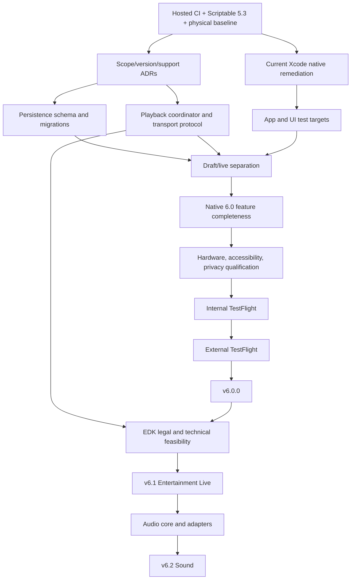

# Hue Board 6 finalization program

**Baseline:** `c82ac4d44a0e7c0dbda91145377b7a1c0cab90f3`  
**Status:** canonical execution plan, not a release claim

Hue Board 6 is a **native-iPhone-first major release**. Scriptable 5.3 becomes the immutable LTS fallback. The 6.0 critical path is deliberately bounded: ship a qualified native application before expanding into Hue Entertainment streaming, Sound, browser control, companion hosts, or AI.

## Release train

| Release | Product contract | Hard boundary |
|---|---|---|
| Scriptable `5.3.0` | Final Scriptable feature release and rollback baseline | Immutable artifact, manifest, installer pin, migration and rollback evidence |
| Native `6.0.0` | Qualified native iPhone GA core | Lights, Scenes, isolated preview, Bridge Play, honest low-rate Ambient Live, recovery, migration, diagnostics, TestFlight and App Store distribution |
| Native `6.1.0` | Conditional Hue Entertainment Live | Requires licensing/distribution approval, supported transport, stream ownership, measured physical qualification |
| Native `6.2.0` | Conditional microphone and local-file Sound | Requires qualified Entertainment transport, audio lifecycle, privacy, interruption and hardware evidence |

## Scope lock for 6.0

### Required

- Signed native iPhone application built with the current release toolchain.
- One active Bridge at a time, with a data model capable of storing multiple profiles safely.
- Everyday room, zone and fixture controls.
- Scene library, favorites, saved looks, isolated preview and versioned import/export.
- Automatic Bridge-owned Play that continues independently after accepted recall.
- Accurately named low-rate **Ambient Live**, never marketed as Entertainment-quality streaming.
- One physical writer, writer epochs and explicit operation IDs.
- Durable recovery with unresolved-fixture retention.
- Versioned persistence and migrations from Scriptable 5.3 and early native builds.
- No writes from launch, discovery, refresh, navigation, import preview, scene editing, scrubbing or preview.
- Privacy manifest, redacted diagnostics, physical-light warning, emergency stop and Reduce Light Motion.
- Real app tests, UI tests, fake-Bridge integration and physical iPhone/Hue qualification.
- Internal and invited external TestFlight.
- Zero open P0/P1 defects.

### Conditional

- Basic App Intents, only if capability-gated and non-blocking.
- iPad and landscape, only if fully tested. Otherwise disable or do not advertise them.
- Bridge Pro, only if physically qualified. Preserve forward-compatible modeling without claiming support.

### Deferred

- Entertainment Live to 6.1 unless its legal and technical gate closes without jeopardizing 6.0.
- Microphone and local-file Sound to 6.2.
- Browser host, local companion, cloud sync, Foundation Models, cross-app audio, Apple Watch, MIDI/OSC and desktop capture.

## Non-negotiable invariants

1. Opening, discovering, pairing, refreshing, navigating, importing, editing a draft, scrubbing and previewing issue no light writes.
2. Exactly one Hue Board writer owns a coordinated Bridge/scope at a time.
3. Every physical operation carries a writer epoch and operation ID.
4. Responses from stale epochs cannot update current state.
5. Preview is structurally unable to write through `NullPreviewTransport`.
6. Bridge acceptance and readback are not optical proof.
7. Unsupported or ambiguous outcomes are explicit, never represented as success.
8. Recovery is captured before the first possibly mutating operation.
9. Original pre-playback snapshots are immutable and only append newly touched fixtures.
10. Partial restore retains unresolved fixtures.
11. Emergency off never discards the recovery journal.
12. Credentials stay in Keychain and never appear in logs, fixtures, screenshots, URLs, exports or CI.
13. Entertainment never silently falls back to REST.
14. No P0/P1 remains open at release.
15. No App Store, hardware, accessibility or safety claim exists without evidence on the exact commit.

## Release gates

### Gate A: close the v5 baseline

- Hosted CI executes real repository steps.
- `main` is protected.
- Scriptable 5.3 is published and rollback-tested.
- The exact native baseline builds, signs, installs, launches, pairs, controls, plays, locks, stops and restores on the real system.

### Gate B: accepted product decisions

The following decisions are accepted and binding unless superseded by a later ADR:

- [ADR 0001: native iPhone GA scope and release train](decisions/0001-native-ga-scope.md)
- [ADR 0002: independent product, build, schema, ABI, protocol and catalog versions](decisions/0002-version-and-schema-model.md)
- [ADR 0003: supported OS, device, Bridge and fixture matrix](decisions/0003-supported-platform-and-hardware-matrix.md)
- [ADR 0004: Scriptable 5.3 LTS and semantic parity policy](decisions/0004-scriptable-lts-and-parity.md)
- [ADR 0005: physical-light health and motion-safety policy](decisions/0005-physical-light-safety.md)

### Gate C: persistence and ownership

- Versioned state envelope.
- Idempotent migration registry.
- Pre-migration backup, malformed-state quarantine and rollback.
- Independently durable recovery journal.
- `PlaybackCoordinator` is the only physical writer.
- Writer epochs reject stale callbacks.
- `LightingTransport` boundary exists.
- Preview uses a no-op transport.

### Gate D: native product completeness

- `SceneDraft` and `ActivePlayback` are distinct.
- Lights, Scenes, Bridge Play and Ambient Live are complete.
- Favorites, saved looks and import/export are complete.
- Now Playing/recovery appears only when relevant.
- Capability and ownership states are explicit.
- Deferred capabilities have no placeholder controls.

### Gate E: application test architecture

- `HueBoardAppTests` and `HueBoardUITests`.
- Deterministic fake Hue Bridge for REST and SSE.
- TLS, rate-limit, disconnect, stale-scene, competing-controller and partial-failure fixtures.
- Launch/no-write, migration, lifecycle, recovery, accessibility and archive validation.

### Gate F: physical qualification

The supported OS/device/Bridge/fixture matrix passes on real hardware. API acknowledgement is not substituted for physical observation.

### Gate G: safety and accessibility

VoiceOver, Dynamic Type, contrast, Reduce Motion, Reduce Transparency, Reduce Light Motion, emergency stop, long names, offline, stale, uncertain and recovery states all pass.

### Gate H: distribution

Internal TestFlight, invited external TestFlight, frozen release candidate, evidence bundle, phased App Store rollout and rollback.

## Critical path



## Architecture target

```text
HueBoardKit
├── contract and version domains
├── scene model and planner
├── capability model
├── operation and recovery state
└── persistence schemas

HueBoardNativeCore
├── discovery and profiles
├── TLS identity and pinning
├── credentials
├── REST and SSE
└── redacted diagnostics

HueBoardAppleEngine
└── JavaScriptCore shared-engine adapter

HueBoard App
├── presentation state
├── PlaybackCoordinator
├── BridgeSession
├── SceneDraftStore
├── MigrationCoordinator
└── SwiftUI surfaces

Transports
├── NullPreviewTransport
├── BridgeSceneTransport
├── RestAmbientTransport
└── EntertainmentTransport (6.1, conditional)
```

Do not perform a repository-wide directory migration before these boundaries are proven. Extract a package only when multiple consumers need a stable contract.

## Parallel work rules

- One issue and one behavioral purpose per branch/worktree.
- Interface PRs land before implementations that depend on them.
- Generated artifacts are regenerated after rebase.
- Every PR names affected invariants, migration impact, security/privacy impact, physical-light safety impact, validation, missing evidence and rollback.
- Independent QA reviews P0/P1 paths.
- `main` remains releasable; no long-lived integration branch.
- Feature flags represent tested capability, not unfinished UI.

## Defect policy

| Class | Meaning | Release rule |
|---|---|---|
| P0 | Unsafe write, wrong target, secret exposure, recovery loss, destructive migration, unstoppable output, crash loop or impossible rollback | Zero open |
| P1 | Supported core flow broken, misleading success, pairing/play/restore failure or inaccessible emergency action | Zero open |
| P2 | Significant bounded defect | Explicit owner and disposition |
| P3 | Cosmetic or polish | May ship if documented |

## Evidence bundle

Every release candidate must produce:

```text
release-evidence/
  manifest.json
  source-commit.txt
  toolchain.txt
  dependency-lock-digest.txt
  test-summary.json
  xcode-result-bundles/
  simulator-matrix.json
  device-matrix.json
  bridge-matrix.json
  migration-results.json
  accessibility-results.json
  safety-results.json
  performance-results.json
  privacy-report.pdf
  artifact-checksums.txt
  known-issues.md
  rollback.md
```

The manifest binds the commit, tag, build number, toolchain, schemas, engine/catalog digests, artifacts, checksums, support matrix and evidence files.

## Immediate execution wave

1. Resolve hosted execution and protect `main`.
2. Publish immutable Scriptable 5.3.
3. Run the deterministic physical-iPhone/Hue baseline.
4. Implement persistence schema 2 and recovery durability using the accepted ADRs.
5. Upgrade the release lane and add real app/UI test targets.
6. Introduce `PlaybackCoordinator`, writer epochs, transport contracts and `NullPreviewTransport`.
7. Enforce draft/live separation.
8. Finish the bounded native 6.0 product and safety surface.
9. Enter TestFlight qualification.

## Canonical files

- [Accepted architecture decisions](decisions/README.md)
- [`defect-register.md`](defect-register.md)
- [`codex-handoff.md`](codex-handoff.md)
- [`work-packages.json`](work-packages.json)
- [`issue-map.md`](issue-map.md)
- Historical broad plan: [`../v6-plan.md`](../v6-plan.md)

## Definition of done

`v6.0.0` is complete when a new user can install the native application, pair a supported Bridge, control daily lighting, preview without writing, start phone-free Bridge Play, run bounded Ambient Live, stop and restore exactly, recover after interruption and relaunch, migrate from v5.3 without loss, export data, use critical accessibility settings and roll back using documented evidence-bound procedures.
