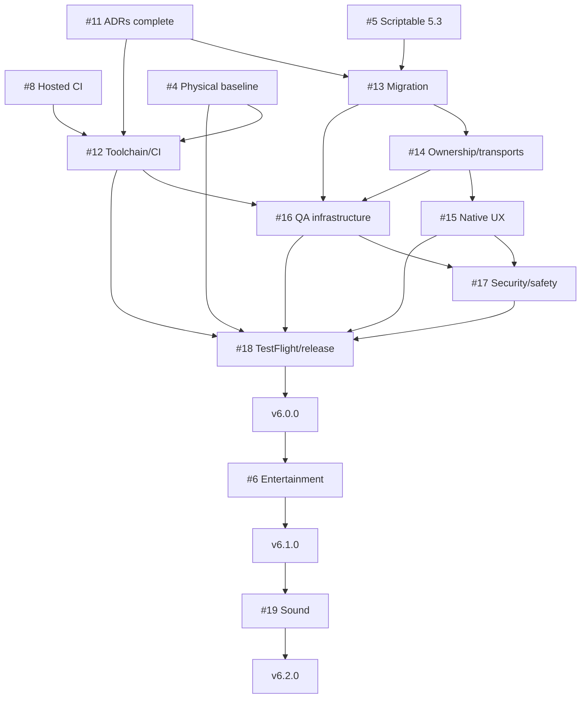

# Hue Board 6 issue map

Parent epic: [#20 Ship Hue Board 6.0 as a qualified native iPhone application](https://github.com/wyattowalsh/hue-board/issues/20)

## Accepted architecture decisions

The v6 decision gate is complete. The normative records are indexed in [`adr/README.md`](adr/README.md):

- [ADR 0001: native iPhone GA scope](adr/0001-native-iphone-ga-scope.md)
- [ADR 0002: independent version and schema domains](adr/0002-version-and-schema-domains.md)
- [ADR 0003: supported platform and hardware matrix](adr/0003-supported-platform-and-hardware-matrix.md)
- [ADR 0004: Scriptable 5.3 LTS and native parity](adr/0004-scriptable-lts-and-native-parity.md)
- [ADR 0005: physical-light safety](adr/0005-physical-light-safety.md)

## Baseline gates

| Issue | Gate | Role |
|---|---|---|
| [#8](https://github.com/wyattowalsh/hue-board/issues/8) | Hosted CI and protected `main` | Must execute real Linux and macOS jobs before required-check enforcement |
| [#5](https://github.com/wyattowalsh/hue-board/issues/5) | Immutable Scriptable 5.3 release | Final Scriptable feature release, LTS fallback and migration/rollback baseline |
| [#4](https://github.com/wyattowalsh/hue-board/issues/4) | Exact native and hardware baseline | Xcode, signed iPhone, Bridge, lifecycle, accessibility and physical-output qualification |

## Native 6.0 work packages

| Issue | Status | Work package | Primary dependency |
|---|---|---|---|
| [#11](https://github.com/wyattowalsh/hue-board/issues/11) | **Complete** | Scope, versioning, support, parity and physical-light safety ADRs | #4, #5 evidence still constrains support claims |
| [#12](https://github.com/wyattowalsh/hue-board/issues/12) | Open | Authoritative release toolchain and CI | #8, #11 |
| [#13](https://github.com/wyattowalsh/hue-board/issues/13) | Open | Persistence schema 2 and migration safety | #5, #11 |
| [#14](https://github.com/wyattowalsh/hue-board/issues/14) | Open | Single-writer ownership and transport boundaries | #11, #13 |
| [#15](https://github.com/wyattowalsh/hue-board/issues/15) | Open | Bounded native product UX | #11, #13, #14 |
| [#16](https://github.com/wyattowalsh/hue-board/issues/16) | Open | App-test and fake-Bridge infrastructure | #12, #13, #14 |
| [#17](https://github.com/wyattowalsh/hue-board/issues/17) | Open | Security, privacy, accessibility and physical-light safety | #11, #12, #15, #16 |
| [#18](https://github.com/wyattowalsh/hue-board/issues/18) | Open | Hardware matrix, TestFlight, evidence and App Store rollout | #4, #12, #15, #16, #17 |

## Conditional follow-on releases

| Issue | Release | Boundary |
|---|---|---|
| [#6](https://github.com/wyattowalsh/hue-board/issues/6) | 6.1 Entertainment Live | Requires EDK legal/distribution approval and supported physical qualification; does not block 6.0 |
| [#19](https://github.com/wyattowalsh/hue-board/issues/19) | 6.2 Sound | Requires qualified Entertainment transport; microphone and local-file sources only; does not block 6.0 |

## Dependency summary

## Working rules

- One behavioral purpose per PR.
- One issue/worktree per active implementation lane.
- Every PR states affected invariants, migration impact, security/privacy impact, physical-light safety impact, evidence, missing evidence and rollback.
- No work package may claim completion from a lower evidence tier than its release claim requires.
- P0/P1 defects block beta promotion and release candidates.
